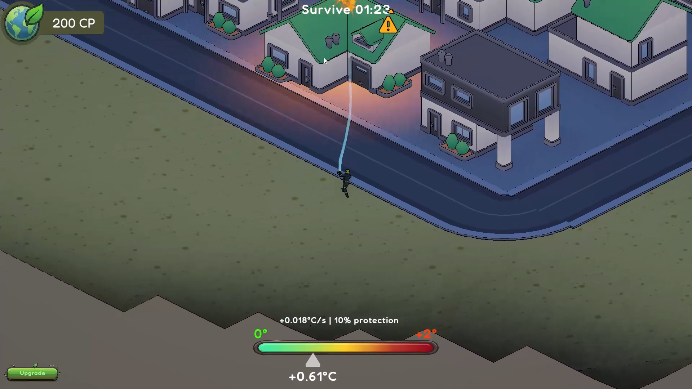
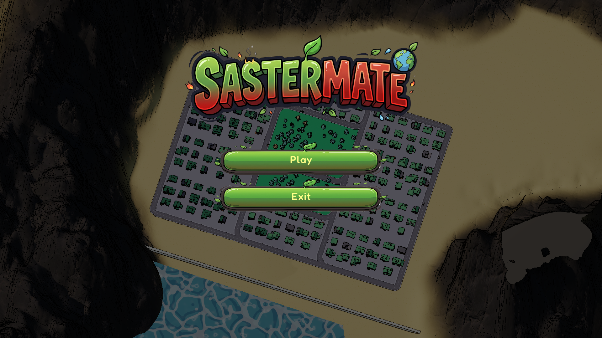
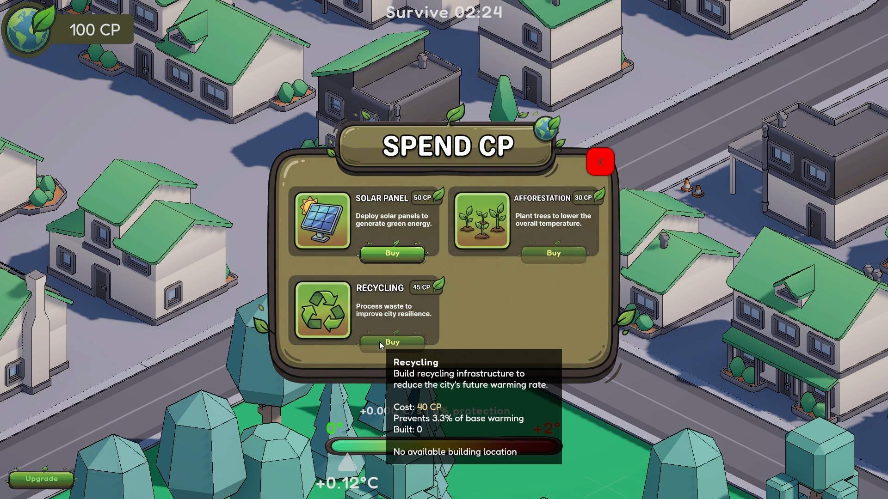
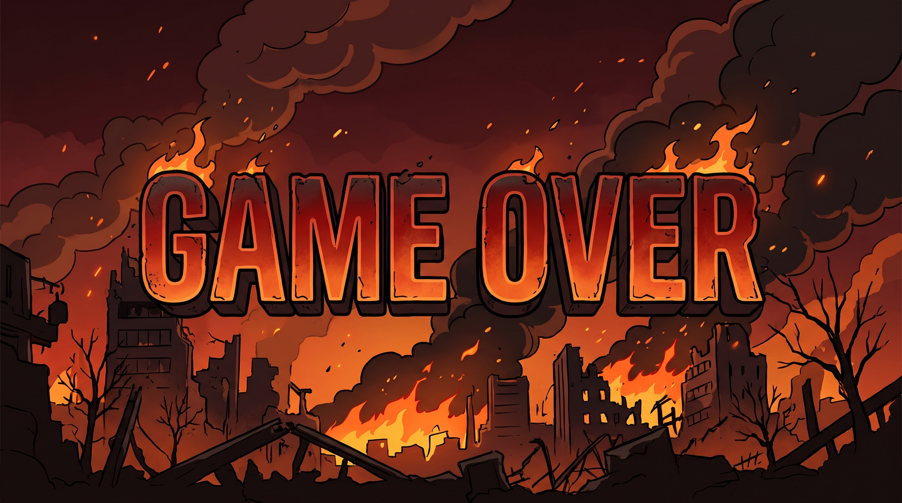

# Sastermate

A climate-crisis city game made for the COP31 Game Jam (2026). Put out fires, earn Carbon Points and invest in green infrastructure to keep global warming below +2.0°C.

## About the game

The year is 2026. You are the new COP31 Representative for the city of Nova, and on your first day a fire breaks out. Your job is not only to respond to emergencies but to make Nova resilient. Every fire pushes the global temperature up, and if it reaches +2.0°C the city is lost. Survive three minutes below that line to win.

- **Crisis response:** fires start on buildings across an isometric city. Aim the hose and put them out before the temperature climbs.
- **Green economy:** every extinguished fire earns Carbon Points (CP). Spend them on solar panels, recycling centers and tree planting, which permanently slow future warming for the rest of the run.
- **Prioritize:** balance fighting the fires in front of you against long-term investment.
- **Made to teach:** the game aims to give younger players a feel for global warming, renewable energy and sustainable living.

## Controls

| Action | Input |
|---|---|
| Move | WASD / arrow keys |
| Aim the hose | Mouse |
| Spray water | Left mouse button |
| Rotate the camera | Q / E |
| Open the upgrade shop | Upgrades button |
| Close the shop, pause or go back | Escape |

You cannot spray while the upgrade shop is open.

## Screenshots

| Main menu | Upgrade shop | Game over |
|---|---|---|
|  |  |  |

## Built with

- Unity 6.3 LTS (6000.3.18f1), C#
- Cinemachine, TextMeshPro, Unity NavMesh and the Input System

Design notes for individual systems (carbon points, upgrades, fire difficulty, win and lose screens) are in [`Docs/`](Docs).

## Credits

Made by VectorViolet during the jam. Third-party assets: Kenney city and nature kits, SimplePoly City, JMO Cartoon FX and the Fredoka font (SIL Open Font License, notice in `Assets/StreamingAssets/ThirdPartyNotices`).

## License

[MIT](LICENSE) for the game's own code and content. Third-party assets keep their own licenses.
